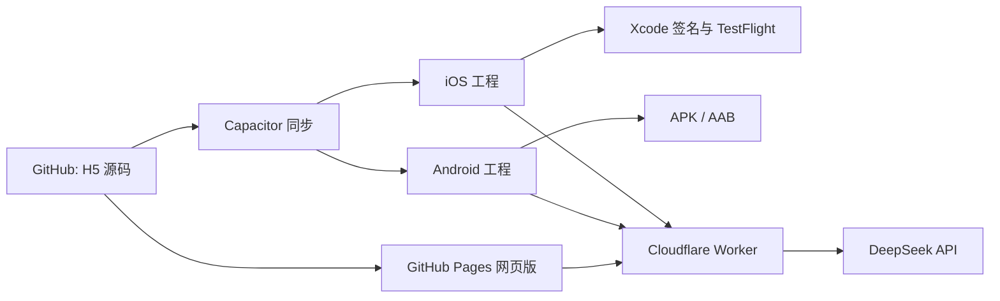

# 好好吃饭产品方案补充：原生手机 APP

更新时间：2026-11-01

## 新增需求

用户希望将现有 H5 继续发展为手机 APP，优先 iPhone，并让同一代码库维护网页和手机应用。随后要求发布手机 APP。

## 方案

使用 Capacitor 封装现有 H5。菜谱、四道菜刷新与单道替换、营养及维生素估算、按周回顾继续复用 `index.html`。GitHub 保存源代码；GitHub Actions 在手机代码更新后自动构建 Android Debug APK 和 iOS 模拟器包，也支持手动运行。iPhone 真机测试/分发需要 Apple 签名及 TestFlight 配置；模拟器构建不等于真机发布。

## 大模型菜单推荐

### 需求

从本地网页菜单改为由 DeepSeek 大模型按用餐类型、人数、口味、时间、预算、现有食材、过敏/忌口和当天愿望搭配。一次推荐荤菜、家常菜、蔬菜、汤品四类；支持整套刷新和单道替换。模型只能从现有菜谱候选中选，程序负责过敏/忌口预过滤、分类/ID校验和保存。

### 架构与安全

网页把偏好和候选菜谱发送给 Cloudflare Worker；Worker 持有 DeepSeek API 密钥并调用模型，验证模型结果后只返回候选菜 ID。API 密钥不得放入网页、GitHub 文件或本机浏览器存储。网页保留本地菜谱作为降级方案。

### 当前状态（2026-11-01）

- GitHub 已有 Worker 源码和配置：[Worker](../worker/src/index.js)、[部署说明](../worker/README.md)。
- 网页端还未配置 Worker URL（`AI_API_URL` 为空），因此当前线上菜单仍走本地 24 道菜谱，不会实际请求模型。
- Worker 尚未部署，Cloudflare 账户授权与 DeepSeek API 密钥尚未设置；这两项完成后还需把 Worker URL 写入网页并发布 Pages 更新。
- 健康检查路由现已支持无 Origin 直接访问，只返回模型名称与密钥是否配置状态。
- 服务器请求有每 IP 简易频率限制，但不是硬性费用上限；正式开放前需要设置费用告警并观察调用量。

## 数据要求

H5 目前将历史和偏好保存在浏览器 localStorage。安装版处于独立沙盒，网页与安装版不会自动共享这份数据。长期使用前要提供本地导入/导出，或设计有账号保护的云同步方案；多设备、家庭成员共享以云同步为目标。

## 当前实现状态

- 已在 GitHub 根目录加入 Capacitor 配置、网页资源复制脚本、iOS/Android 依赖、Actions 构建工作流、仓库说明和数据迁移说明。
- GitHub Actions 构建运行 [41230809428](https://github.com/200611lxzys/lunch-menu-app/actions/runs/41230809428) 已成功：生成 Android Debug APK 与 iOS 模拟器包。APK 可供 Android 测试；iOS 模拟器包不能安装到 iPhone。
- 手机代码更新会触发构建；可在 Actions 下载构建产物。
- 正式 iPhone 发布尚未完成：需要账户持有人完成 Apple Developer Program 注册/协议/付款，然后用其签名凭据生成可提交 App Store Connect 的真机构建并走 TestFlight 分发。
- 现有网页历史尚未迁移到安装版，长期使用前需增加导入或云同步。
