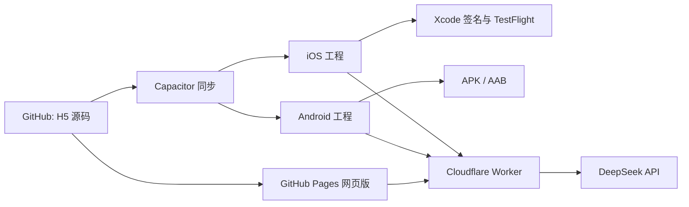

# 好好吃饭产品方案补充：原生手机 APP

更新时间：2026-11-01

## 新增需求

用户希望将现有 H5 继续发展为手机 APP，优先 iPhone，并让同一代码库维护网页和手机应用。随后要求发布手机 APP。

## 方案

使用 Capacitor 封装现有 H5。菜谱、四道菜刷新与单道替换、营养及维生素估算、按周回顾继续复用 `index.html`。GitHub 保存源代码；GitHub Actions 在手机代码更新后自动构建 Android Debug APK 和 iOS 模拟器包，也支持手动运行。iPhone 真机测试/分发需要 Apple 签名及 TestFlight 配置；模拟器构建不等于真机发布。

## 大模型菜单推荐

### 需求

从本地网页菜单改为由 DeepSeek 大模型按用餐类型、人数、口味、时间、预算、现有食材、过敏/忌口和当天愿望搭配。一次推荐荤菜、家常菜、蔬菜、汤品四类；支持整套刷新和单道替换。模型只能从现有菜谱候选中选，程序负责过敏/忌口预过滤、分类/ID校验和保存。

### 架构与安全

网页把偏好和候选菜谱发送给 Cloudflare Worker；Worker 持有 DeepSeek API 密钥并调用模型，验证模型结果后只返回候选菜 ID。API 密钥不得放入网页、GitHub 文件或本机浏览器存储。网页保留本地菜谱作为降级方案。

### 当前状态（2026-11-01）

- GitHub 已有 Worker 源码和配置：[Worker](../worker/src/index.js)、[部署说明](../worker/README.md)。
- 网页端还未配置 Worker URL（`AI_API_URL` 为空），因此当前线上菜单仍走本地 24 道菜谱，不会实际请求模型。
- 家庭试用额度控制已加入网页，但模型暂未实际启用；因为 Worker 未部署且 `AI_API_URL` 仍为空。
- Worker 尚未部署，Cloudflare 账户授权与 DeepSeek API 密钥尚未设置；这两项完成后还需把 Worker URL 写入网页并发布 Pages 更新。
- 健康检查路由现已支持无 Origin 直接访问，只返回模型名称与密钥是否配置状态。
- 服务器请求有每 IP 简易频率限制，但不是硬性费用上限；正式开放前需要设置费用告警并观察调用量。

## 成本与付费方案

### 谁向服务商付费

Cloudflare Worker 和 DeepSeek API 都由应用运营者（当前是开发者/账号持有人）账户开通并结算。终端用户不会直接收到 DeepSeek 账单。若以后收费，用户向应用运营主体支付订阅费，运营主体再支付 Cloudflare 与 DeepSeek 的账单；API 密钥始终只保存在 Worker 服务端。

### 分阶段方案

1. **家庭试用期：运营者垫付（用户已选择先执行）。** 先用 Cloudflare Workers 免费额度；DeepSeek 按实际 Token 用量从 API 账户余额扣费。网页现设每设备每天最多 1 次大模型整套搭配、3 次大模型换菜；超额后仍可用本地菜谱刷新。这个设备级计数适合两人试用，不是服务器端的身份额度或账单硬上限。上线前需完成 Cloudflare Worker 部署和 DeepSeek 密钥配置。
2. **小规模内测：继续由运营者付费，先观测后收费。** 加入登录、按家庭账户计数、每日免费额度、全站每日调用上限、费用告警和异常流量熔断。当前每 IP 每分钟限制只能防突发，不能限制月账单；不能把它当预算上限。
3. **公开运营：由订阅收入覆盖服务费用。** 采用免费基础额度加家庭订阅的方式；免费账户限制每日生成/替换次数，订阅账户提高额度。先用 2–4 周内测采集真实 Token 成本和家庭使用意愿，再决定月付/年付价格，不在未验证前承诺固定价格或无限量使用。

### 费用估算示例（非报价）

DeepSeek 官方当前按输入/输出 Token 计费。按偏保守的高峰、未命中缓存单次 **3,000 输入 Token + 400 输出 Token** 假设，使用当前 Flash 价格（输入每百万 $0.30、输出每百万 $1.20），约 **$0.00138/次**。这只是模型调用估算，不包括其他运营、支付和税费；实际会随提示内容、模型思考输出、峰谷时段及缓存命中变化。

| 日活家庭数 | 每户每天调用 | 月调用量（按 30 天） | DeepSeek 示例月费 |
|---:|---:|---:|---:|
| 100 | 1 次 | 3,000 | 约 $4.14 |
| 1,000 | 1 次 | 30,000 | 约 $41.40 |
| 10,000 | 1 次 | 300,000 | 约 $414 |
| 10,000 | 3 次（含替换） | 900,000 | 约 $1,242 |

Cloudflare Workers 免费计划目前包含每天 100,000 次请求；付费 Workers 计划最低 $5/月，并含每月 10M 次请求额度，超出后按量计费。按上表低/中等调用量，Cloudflare 请求费可能仍在免费额度内；爆量或并发增加时需启用付费计划并监控。费用以 [Cloudflare 官方价格](https://developers.cloudflare.com/workers/platform/pricing/) 和 [DeepSeek 官方价格](https://api-docs.deepseek.com/quick_start/pricing/)为准。

### 正式开放前必须补齐的成本控制

- 增加身份认证和家庭账户，不能只靠 IP 识别用户。
- 在 Worker 中记录账户级每日调用数、模型 Token 用量和错误数。
- 设置全站每日/每月硬上限；达到上限时停止大模型请求，改用本地菜单并提示稍后再试。
- 配置 DeepSeek 余额/用量告警，定期核对账单。
- 给免费和订阅账户设置清晰的公平使用额度，禁止“无限量”承诺。

## 数据要求

H5 目前将历史和偏好保存在浏览器 localStorage。安装版处于独立沙盒，网页与安装版不会自动共享这份数据。长期使用前要提供本地导入/导出，或设计有账号保护的云同步方案；多设备、家庭成员共享以云同步为目标。

## 当前实现状态

- 已在 GitHub 根目录加入 Capacitor 配置、网页资源复制脚本、iOS/Android 依赖、Actions 构建工作流、仓库说明和数据迁移说明。
- GitHub Actions 构建运行 [41230809428](https://github.com/200611lxzys/lunch-menu-app/actions/runs/41230809428) 已成功：生成 Android Debug APK 与 iOS 模拟器包。APK 可供 Android 测试；iOS 模拟器包不能安装到 iPhone。
- 手机代码更新会触发构建；可在 Actions 下载构建产物。
- 正式 iPhone 发布尚未完成：需要账户持有人完成 Apple Developer Program 注册/协议/付款，然后用其签名凭据生成可提交 App Store Connect 的真机构建并走 TestFlight 分发。
- 现有网页历史尚未迁移到安装版，长期使用前需增加导入或云同步。
