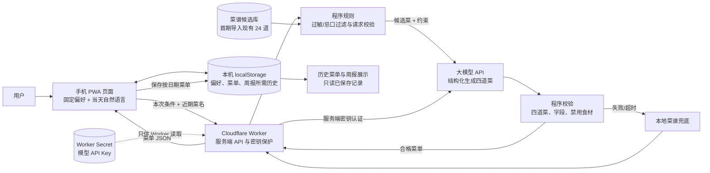
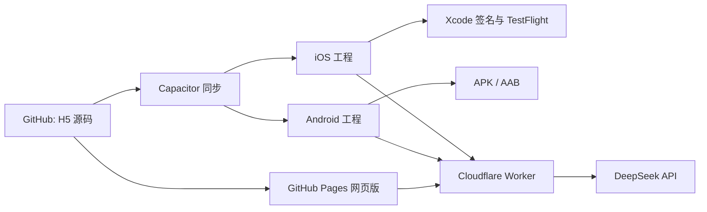

# 「好好吃饭」产品方案（大模型推荐版）

> 版本：产品方案 v2 · 更新日期：2026-11-01  
> 状态：前端偏好界面和 Worker 源码已加入 GitHub，GitHub Pages 前端部署成功；Worker 尚未部署，API Key 与 Worker 地址尚未配置，因此线上推荐目前仍使用本地 24 道菜谱。

## 1. 产品定位

帮助家庭安排一顿饭的菜单，可用于午餐或晚餐。用户设置家庭饮食偏好后，由大模型结合菜谱资料和历史菜单推荐四道菜；页面展示食材、做法和营养估算，并支持逐道替换、整套刷新及每周复盘。

产品原则：**模型负责理解偏好、搭配与表达；程序负责硬性规则、校验、营养计算调用和保存；可信菜谱/营养数据负责提供事实依据。**

## 2. 用户与场景

- **目标用户：** 想减少每天安排家庭菜单、查食材和做法时间的家庭成员。
- **主要场景：** 早上或买菜前查看今日菜单，补充当天想法；按口味换菜；一周后回看已生成菜单和估算。
- **使用端：** 手机优先的 PWA 网页，可添加到 iPhone 或 Android 主屏幕。
- **用餐范围：** 每天只规划一顿饭，用户可标记为午餐或晚餐；不安排早餐和加餐。

## 3. 已确认需求

1. 每天推荐一顿饭、四道菜；界面使用“今日菜单 / 本餐”等通用文案。
2. 菜品展示名称、食材及用量、下厨步骤、热量和宏量营养估算、主要维生素来源。
3. 用户可替换单道菜或刷新四道菜；生成结果按日期保存。
4. 首次使用日为第 1 天；可以查看今天和过往菜单，不显示未来菜单。
5. 周期以首次使用日为锚点，每 7 天一周；本周按已发生日期统计，可查看过去周报。
6. 推荐机制、营养口径、模型使用情况和数据保存范围需要在 App 中说明。
7. 计划接入大模型，并提供可编辑的饮食偏好设置；设置界面采用固定项为主、自然语言补充为辅。

## 4. 饮食设置与菜单流程

### 4.1 固定偏好（用户可保存）

- 用餐人数；默认用餐类型可选午餐或晚餐。
- 口味、辣度、清淡程度等偏好。
- 不吃的食材、过敏食材（作为严格限制处理）。
- 可选的预算范围、备餐时长、常用食材。

固定设置可编辑、清空。过敏与忌口使用明确的结构化选项或食材标签；不能只把一句自然语言提示交给模型。

### 4.2 当天补充（可选自然语言）

提供“今天还想怎么吃？”输入框，例如：“想吃鱼，半小时内做好，优先用冰箱里的豆腐。”用户无需每天重复固定偏好。

### 4.3 生成和替换

1. 首次打开当天菜单时，前端把固定偏好、当天补充、近期菜名和日期发给服务端。
2. 服务端先按过敏、忌口等硬限制过滤候选菜，再向模型请求四道菜及结构化字段。
3. 程序校验菜数、字段、分类及禁用食材；不通过时有限重试，仍失败则使用本地菜谱兜底并提示。
4. 通过后保存菜单并显示。回看历史、打开周报不重新调用模型。
5. 单菜替换只提交该菜的分类和约束；整套刷新重新生成四道菜。每次成功结果覆盖或记录在对应日期，供周报回看。

## 5. 推荐方案与边界

### 5.1 第一阶段：受控的混合推荐

采用“菜谱候选资料 + 程序筛选 + 大模型搭配”的方式。现有 24 道手工整理菜谱作为初始候选库；模型可依据口味、当天要求和近期菜单进行搭配、排序与解释。候选不足时，可在服务端允许的范围内生成新菜谱；新生成内容要标为 AI 菜谱并经过同样的结构与禁忌校验。

初期不默认联网搜索。若未来需要时令食材、外部菜谱或实时价格，再单独接入可审查的数据源并记录来源。加入智能体不是首版前置条件：一次模型调用和确定性的程序校验足以支撑第一版；当确实需要模型自主调用菜谱库、营养库或搜索工具时再加智能体编排。

### 5.2 约束与可信度

- **硬性约束由程序落实：** 过敏/禁忌过滤、四道菜数量、输出字段、重复菜提醒。模型指令不能替代程序校验。
- **营养不由模型凭空报精确值：** 首版沿用菜谱粗估并标注不确定性；接入可靠食物成分数据后，按食材和份量计算。维生素来源标签不是精确含量或达标结论。
- **模型来源透明：** 设置/说明页展示实际模型服务商和模型标识；首期采用 DeepSeek API `deepseek-flash`，服务端通过 OpenAI 兼容格式调用。
- **调用可控：** 每天首次生成、用户主动换菜或刷新时调用；已保存菜单的浏览和周报统计不调用，减少重复请求。
- **失败回退：** 网络、服务或模型输出失败时保留已有菜单；新菜单可回退本地菜谱，并清楚提示。

## 6. 系统架构

首版保持 GitHub Pages 前端，另加一个轻量服务端代理。浏览器不保存模型 API 密钥。用户偏好和菜单历史第一阶段仍保存在当前设备；前端只把本次推荐所需的偏好和近期菜名发给服务端。云端账号与跨设备同步另列后续阶段。

### 6.1 架构组件说明

- **PWA 前端：** 菜单页、偏好设置页、当天补充输入、替换操作和周报。沿用现有网址与主屏幕入口。
- **本机存储：** 首版继续保存用户设置和菜单历史；不同设备/浏览器不自动共享，清除网站数据会删除记录。
- **服务端代理：** 推荐采用 Cloudflare Worker（实施时核实账户、部署和调用成本）。代理校验请求、处理菜谱候选、调用模型并校验结果。
- **模型 API：** 提供生成能力；密钥只放在服务端 Secret，不提交到 GitHub，也不放进网页源代码。
- **菜谱资料：** 初始复用当前手工整理的 24 道菜。后续扩充时记录来源、份量、过敏原及营养数据出处。
- **营养资料：** 首版继续标注为粗略估算；是否接入权威食物成分数据源待后续选型。

## 7. 数据结构建议

模型请求输入包括：日期、用餐人数/类型、固定偏好、忌口与过敏标签、当天自然语言补充、近期菜单摘要、可选的候选菜谱。

模型响应建议按固定 JSON Schema 返回：

- `meal_type`：午餐/晚餐/通用。
- `dishes`：恰好四项；每项含菜名、菜品类别、食材与用量、步骤、推荐理由、菜谱来源/是否 AI 生成。
- `nutrition_source`：数值来源说明；若没有可靠数据源，明确为粗估。

服务端/前端保存菜单日期、偏好快照、四道菜内容、生成方式、创建/更新时间和营养口径。保存偏好快照可避免用户以后改设置时，旧周报被重新解释。

## 8. 页面与产品模块

1. **今日菜单：** 日期、用餐类型、四道菜、营养估算、换一道、刷新四道菜。
2. **饮食设置：** 固定选择项；展示并单独确认过敏/禁忌；提供偏好说明。
3. **当天补充：** 一句自然语言愿望，非必填。
4. **每周复盘：** 按首次使用日起每 7 天分组，展示已生成菜单、热量/宏量营养估算、维生素来源覆盖与菜品多样性，可翻看过去周。
5. **推荐说明：** 展示模型服务商/模型标识、是否使用候选菜谱、何时联网、营养估算口径、本机存储说明。
6. **异常提示：** 模型不可用时说明已使用本地候选菜单或保留旧菜单；不得显示空白内容或悄悄丢弃历史。

## 9. MVP 实施阶段

### 阶段 A：接模型的最小闭环

- 增加固定偏好和自然语言补充表单。
- 增加服务端 Worker，安全保存密钥。
- 让模型基于候选菜谱生成四菜 JSON；实现硬约束检查、有限重试和本地回退。
- 成功菜单写入现有本机日期历史；替换与周报读取已保存结果。
- 明示模型实际名称、费用说明入口、营养口径和数据流向。

### 阶段 B：提高丰富度与个性化

- 扩大有来源记录的菜谱资料；让用户标记喜欢/不喜欢/实际做过。
- 根据最近菜单降低重复率。
- 评估可靠营养数据源并替换菜谱粗估。
- 若用户需要跨设备使用，再增加账号、云端数据库和本地历史迁移。

## 10. 验收标准

- 无论用户偏好如何，每日只生成一顿饭的四道菜；页面不出现早餐/加餐，文案不限定午餐或晚餐。
- 固定偏好和当天补充能分别编辑；清楚标示哪些条件是硬限制。
- 对过敏/禁忌食材，程序在发送模型前过滤候选，并在返回后再次检查；违规结果不得显示为成功。
- 模型返回固定结构，四道菜均含食材、用量和步骤；程序拒绝空菜、缺字段和错误数量。
- 一天首次生成成功后按日保存；再打开该日期、看周报不会额外生成新菜单。
- 单菜替换只更新目标菜；刷新整套会重新生成四道菜；保存结果可在历史日期和周报中回看。
- 模型失败或网络断开时保留已有数据，并提供明确本地兜底提示。
- 服务端密钥不出现在网页代码、GitHub 仓库或浏览器请求参数中。
- 营养与维生素说明不伪装为精确摄入量；周报统计菜单计划而非实际吃下的食物。
- 日期与周报沿用首次使用日起算规则，不允许未来日期或未来周。

## 11. 费用、隐私与风险

- 模型调用按服务商实际计费；费用受模型、输入/输出长度及调用次数影响。页面浏览和历史回顾不触发模型调用，主动生成/换菜才调用。
- 请求只发送推荐所需信息。饮食忌口和过敏偏好可能属于敏感个人信息，应避免收集姓名、精确地址等无关信息，并在页面说明信息会发送给模型服务商处理。
- 模型可能遗漏限制、生成不完整做法或误报营养；程序校验、可信菜谱资料、失败回退和清晰标注共同降低风险，但不能替代专业营养或医疗建议。
- 第一阶段仅本机保存，不自动跨设备同步；上线云同步前需另行设计账户、备份和迁移。
- 服务商和首期模型已选定；Worker 部署账户/Secret、调用预算和营养数据库尚未配置。方案不声称已完成接入。

## 12. 现状与待决事项

- **已上线：** 手机 PWA、四类本地菜谱（24 道）、按日期保存、单菜/整套替换、过去菜单与周报、粗略宏量营养和维生素来源标注。
- **源码已准备但未启用：** 饮食偏好表单、当天自然语言输入、DeepSeek Worker、服务端过敏/忌口候选过滤、模型响应校验和限流。须先部署 Worker、设置 DeepSeek Secret、配置前端 Worker 地址，模型推荐才能实际运行。
- **仍未实现：** 联网搜索、独立营养数据库、账号与跨设备同步。
- **待技术实施时确定：** Worker 部署账户/套餐、调用成本上限、扩充菜谱和营养数据来源。

## 13. 接入决策记录（2026-11-01）

- 首期使用 DeepSeek API `deepseek-flash`，当前服务版本为 DeepSeek-V4.1-Flash-1017；用于中文家庭菜单偏好理解与四菜搭配。
- 采用“候选菜谱 + 模型选择 + 程序校验”，初期只从现有 24 道菜中选择，不开放任意自由生成，控制食材/步骤可靠性。
- 不默认启用联网搜索或智能体；先以一次 API 调用完成推荐，代码负责过敏/忌口检查、保存和本地回退。
- API Key 由用户在服务端 Secret 中配置，不经聊天传递、不进网页源代码或 GitHub。
- 实施状态：产品方案已更新；前端设置界面和 Worker 源码已提交到 GitHub，Pages 发布成功。尚未部署 Worker、设置 API Key 或填写 Worker 地址，所以不能称为已接通大模型。

## 14. 产品文档维护约定

每次收到新的产品需求，先更新本方案中的已确认要求、产品范围、架构、验收标准和实现状态，再据此实现代码。完成后同步记录实际状态、限制与后续项。GitHub 仓库中的 `docs/product-plan.md` 是当前维护版；本地文件是原始完整方案副本。后续新需求以 GitHub 维护版为准并持续记录，架构图描述目标方案，不代表相关服务已部署。

# 实施补充：手机 APP、家庭试用与当前状态

## 新增需求

用户希望将现有 H5 继续发展为手机 APP，优先 iPhone，并让同一代码库维护网页和手机应用。随后要求发布手机 APP。

## 方案

使用 Capacitor 封装现有 H5。菜谱、四道菜刷新与单道替换、营养及维生素估算、按周回顾继续复用 `index.html`。GitHub 保存源代码；GitHub Actions 在手机代码更新后自动构建 Android Debug APK 和 iOS 模拟器包，也支持手动运行。iPhone 真机测试/分发需要 Apple 签名及 TestFlight 配置；模拟器构建不等于真机发布。

## 大模型菜单推荐

### 需求

从本地网页菜单改为由 DeepSeek 大模型按用餐类型、人数、口味、时间、预算、现有食材、过敏/忌口和当天愿望搭配。一次推荐荤菜、家常菜、蔬菜、汤品四类；支持整套刷新和单道替换。模型只能从现有菜谱候选中选，程序负责过敏/忌口预过滤、分类/ID校验和保存。

### 架构与安全

网页把偏好和候选菜谱发送给 Cloudflare Worker；Worker 持有 DeepSeek API 密钥并调用模型，验证模型结果后只返回候选菜 ID。API 密钥不得放入网页、GitHub 文件或本机浏览器存储。网页保留本地菜谱作为降级方案。

### 当前状态（2026-11-01）

- GitHub 已有 Worker 源码和配置：[Worker](../worker/src/index.js)、[部署说明](../worker/README.md)。
- 网页端还未配置 Worker URL（`AI_API_URL` 为空），因此当前线上菜单仍走本地 24 道菜谱，不会实际请求模型。
- 家庭试用额度控制已加入网页，但模型暂未实际启用；因为 Worker 未部署且 `AI_API_URL` 仍为空。
- Worker 尚未部署，Cloudflare 账户授权与 DeepSeek API 密钥尚未设置；这两项完成后还需把 Worker URL 写入网页并发布 Pages 更新。
- 健康检查路由现已支持无 Origin 直接访问，只返回模型名称与密钥是否配置状态。
- 服务器请求有每 IP 简易频率限制，但不是硬性费用上限；正式开放前需要设置费用告警并观察调用量。

## 成本与付费方案

### 谁向服务商付费

Cloudflare Worker 和 DeepSeek API 都由应用运营者（当前是开发者/账号持有人）账户开通并结算。终端用户不会直接收到 DeepSeek 账单。若以后收费，用户向应用运营主体支付订阅费，运营主体再支付 Cloudflare 与 DeepSeek 的账单；API 密钥始终只保存在 Worker 服务端。

### 分阶段方案

1. **家庭试用期：运营者垫付（用户已选择先执行）。** 先用 Cloudflare Workers 免费额度；DeepSeek 按实际 Token 用量从 API 账户余额扣费。网页现设每设备每天最多 1 次大模型整套搭配、3 次大模型换菜；超额后仍可用本地菜谱刷新。这个设备级计数适合两人试用，不是服务器端的身份额度或账单硬上限。上线前需完成 Cloudflare Worker 部署和 DeepSeek 密钥配置。
2. **小规模内测：继续由运营者付费，先观测后收费。** 加入登录、按家庭账户计数、每日免费额度、全站每日调用上限、费用告警和异常流量熔断。当前每 IP 每分钟限制只能防突发，不能限制月账单；不能把它当预算上限。
3. **公开运营：由订阅收入覆盖服务费用。** 采用免费基础额度加家庭订阅的方式；免费账户限制每日生成/替换次数，订阅账户提高额度。先用 2–4 周内测采集真实 Token 成本和家庭使用意愿，再决定月付/年付价格，不在未验证前承诺固定价格或无限量使用。

### 费用估算示例（非报价）

DeepSeek 官方当前按输入/输出 Token 计费。按偏保守的高峰、未命中缓存单次 **3,000 输入 Token + 400 输出 Token** 假设，使用当前 Flash 价格（输入每百万 $0.30、输出每百万 $1.20），约 **$0.00138/次**。这只是模型调用估算，不包括其他运营、支付和税费；实际会随提示内容、模型思考输出、峰谷时段及缓存命中变化。

| 日活家庭数 | 每户每天调用 | 月调用量（按 30 天） | DeepSeek 示例月费 |
|---:|---:|---:|---:|
| 100 | 1 次 | 3,000 | 约 $4.14 |
| 1,000 | 1 次 | 30,000 | 约 $41.40 |
| 10,000 | 1 次 | 300,000 | 约 $414 |
| 10,000 | 3 次（含替换） | 900,000 | 约 $1,242 |

Cloudflare Workers 免费计划目前包含每天 100,000 次请求；付费 Workers 计划最低 $5/月，并含每月 10M 次请求额度，超出后按量计费。按上表低/中等调用量，Cloudflare 请求费可能仍在免费额度内；爆量或并发增加时需启用付费计划并监控。费用以 [Cloudflare 官方价格](https://developers.cloudflare.com/workers/platform/pricing/) 和 [DeepSeek 官方价格](https://api-docs.deepseek.com/quick_start/pricing/)为准。

### 正式开放前必须补齐的成本控制

- 增加身份认证和家庭账户，不能只靠 IP 识别用户。
- 在 Worker 中记录账户级每日调用数、模型 Token 用量和错误数。
- 设置全站每日/每月硬上限；达到上限时停止大模型请求，改用本地菜单并提示稍后再试。
- 配置 DeepSeek 余额/用量告警，定期核对账单。
- 给免费和订阅账户设置清晰的公平使用额度，禁止“无限量”承诺。

## 数据要求

H5 目前将历史和偏好保存在浏览器 localStorage。安装版处于独立沙盒，网页与安装版不会自动共享这份数据。长期使用前要提供本地导入/导出，或设计有账号保护的云同步方案；多设备、家庭成员共享以云同步为目标。

## 当前实现状态

- 已在 GitHub 根目录加入 Capacitor 配置、网页资源复制脚本、iOS/Android 依赖、Actions 构建工作流、仓库说明和数据迁移说明。
- GitHub Actions 构建运行 [41230809428](https://github.com/200611lxzys/lunch-menu-app/actions/runs/41230809428) 已成功：生成 Android Debug APK 与 iOS 模拟器包。APK 可供 Android 测试；iOS 模拟器包不能安装到 iPhone。
- 手机代码更新会触发构建；可在 Actions 下载构建产物。
- 正式 iPhone 发布尚未完成：需要账户持有人完成 Apple Developer Program 注册/协议/付款，然后用其签名凭据生成可提交 App Store Connect 的真机构建并走 TestFlight 分发。
- 现有网页历史尚未迁移到安装版，长期使用前需增加导入或云同步。
